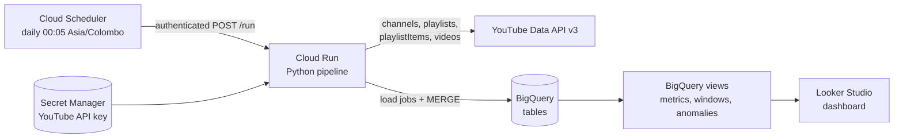

# TV Derana YouTube Performance Pipeline

Daily, fully automated YouTube performance reporting for one channel (default: **TV Derana**, `@tvderanaofficial`).

* **Extract / Load** – Python pulls public data from the **YouTube Data API v3** and loads it into **BigQuery**.
* **Transform** – BigQuery views turn daily snapshots into report-ready tables (the "T" of ELT).
* **Run** – the code runs on **Cloud Run** (built from source, no Dockerfile) and **Cloud Scheduler** calls it every day.
* **Visualise** – a **Looker Studio** dashboard reads the BigQuery views directly.

After the one-time setup nothing needs to be touched: the schedule collects data every day and the dashboard updates itself.



---

## What the dashboard answers

| # | Question | Where it comes from |
|---|----------|---------------------|
| 1 | Total channel views in the period | `v_channel_daily.views_gained` |
| 2 | Subscribers gained / lost | `v_channel_daily.subscribers_gained` |
| 3 | Videos uploaded | `v_window_summary`, `v_videos_latest`, `v_channel_daily.uploads` |
| 4 | Engagement (likes, comments) | `v_channel_daily.likes_gained / comments_gained` |
| 5 | Views up or down vs last week | `v_rolling_comparison`, `v_weekly_summary` |
| 6 | Subscriber growth faster or slower | `v_rolling_comparison`, `v_weekly_summary` |
| 7 | Best and worst days | `v_channel_daily` (by `report_date` and `weekday`) |
| 8 | Top-performing videos | `v_window_videos` (24h / 7d / 28d), `v_videos_latest` |
| 9 | Highest growth this week | `v_videos_latest.views_gained_7d` |
| 10 | Underperformed or dropped | `v_videos_latest.performance_label`, `momentum` |
| 11 | Shorts vs long-form | `v_window_summary`, `v_breakdown_daily` |
| 12 | Format with most engagement and reach | `v_window_summary`, `v_breakdown_daily` |
| 13 | Best categories (News, Dream Star, Reality shows, Entertainment, Sports) | `v_breakdown_daily.category` |
| 14 | Program contributing most views | `v_breakdown_daily.program` (playlist/program mapping) |
| 15 | Time slots with the highest views | `v_time_slots` |
| 16 | Sudden spikes or drops | `v_anomalies`, `v_channel_daily.anomaly_flag` |

Assessment requirements (uploads in the last 24 hours, counts for 24h / 7d / 28d, top videos per window, sorting by views / likes / comments, date range filter) are covered by `v_window_videos` and `v_window_summary`. The required per-video daily dataset is `v_report_daily`.

Shares are **not** available from the YouTube Data API v3, see [docs/ASSUMPTIONS_AND_LIMITATIONS.md](docs/ASSUMPTIONS_AND_LIMITATIONS.md).

---

## Quick start (about 15 minutes)

Requirements: a Google account and a Google Cloud project with **billing enabled** (usage stays within the free tier).
Everything below runs in **Google Cloud Shell**, which already has `gcloud`, `bq`, `git` and Python installed – nothing to install locally.

1. Open Cloud Shell: <https://shell.cloud.google.com>
2. Get the code:

   ```bash
   git clone <this-repository-url> tv-derana-youtube-pipeline
   cd tv-derana-youtube-pipeline
   ```

3. Create the configuration file and set your project ID:

   ```bash
   cp .env.example .env
   nano .env        # set PROJECT_ID=..., save with Ctrl+O, Enter, Ctrl+X
   ```

4. Run the setup (enables APIs, creates the API key, BigQuery dataset, Cloud Run service, daily schedule, then does a first run):

   ```bash
   bash scripts/setup_gcp.sh
   ```

   The last lines print a JSON summary such as `"status": "success", "videos_tracked": 1234`.

5. Build the dashboard: follow [docs/DASHBOARD.md](docs/DASHBOARD.md). This prints a link that creates the report already connected to BigQuery:

   ```bash
   python3 scripts/looker_link.py
   ```

Full walkthrough and troubleshooting: [docs/SETUP_GCP.md](docs/SETUP_GCP.md).

---

## Everyday commands

| Task | Command |
|------|---------|
| Run the pipeline now | `bash scripts/run_now.sh` |
| Deploy after changing code, `.env` or `config/category_rules.json` | `bash scripts/deploy.sh` |
| See logs | `gcloud run services logs read yt-derana-pipeline --region us-central1 --limit 50` |
| List playlists and the category each maps to | `python3 scripts/review_playlists.py` (needs `YOUTUBE_API_KEY` in `.env`) |
| Remove all cloud resources | `bash scripts/teardown_gcp.sh` (add `--delete-data` to drop BigQuery too) |

---

## Run locally (optional)

Useful for testing changes before deploying. Requires Python 3.11+ and, for BigQuery writes, the Google Cloud CLI.

```bash
python3 -m venv .venv
source .venv/bin/activate            # Windows: .venv\Scripts\activate
pip install -r requirements-dev.txt

# put a YouTube API key in .env (YOUTUBE_API_KEY=...). To reuse the key created by setup:
gcloud secrets versions access latest --secret=youtube-api-key

python -m pipeline.run --dry-run     # YouTube API only, writes nothing
gcloud auth application-default login
python -m pipeline.run --init-only   # create dataset, tables and views
python -m pipeline.run               # full run into BigQuery
pytest                               # unit tests (no cloud access needed)
```

---

## How it works

Each daily run:

1. Resolves the channel (`CHANNEL_HANDLE` or `CHANNEL_ID`) and reads its statistics (subscribers, lifetime views).
2. Walks the channel's **uploads playlist** (newest first) and keeps every video published in the last `LOOKBACK_DAYS` (default 90).
3. Fetches details and statistics for those videos in batches of 50.
4. Classifies **Shorts vs long-form** using the channel's auto-generated Shorts playlist, then the `youtube.com/shorts/<id>` check, then duration as a fallback.
5. Reads the channel's playlists and maps videos to playlists (only playlists that changed, plus a weekly full refresh).
6. Writes to BigQuery with batch load jobs: dimension tables are upserted with `MERGE`; the day's snapshot partition is replaced, so re-running on the same day never creates duplicates.
7. Re-creates the views and logs the run in `pipeline_runs`.

Daily snapshots are what make trend questions possible: "views gained" for a day is the difference between two consecutive snapshots.

A typical run uses roughly 300–3,000 of the 10,000 free daily YouTube API quota units and finishes in a few minutes.

### Categories and programs

`config/category_rules.json` maps videos to the categories **News, Dream Star, Reality shows, Entertainment, Sports** (anything unmatched is `Other`) and to a program name. Each rule is a regular expression matched against the video title plus the names of all playlists the video belongs to; the lowest `priority` wins. When a rule has no program name, the video's main playlist is used as the program. Run `python3 scripts/review_playlists.py` to see how the channel's playlists are mapped, adjust the rules, then `bash scripts/deploy.sh`. Because categorisation happens in BigQuery views, new rules apply to all historical data.

---

## Project structure

```
.
├── main.py                     Cloud Run entry point (Flask: GET / health, POST /run)
├── Procfile                    Start command for the Cloud Run Python buildpack
├── requirements.txt            Runtime dependencies
├── .env.example                All settings, copy to .env
├── config/category_rules.json  Category / program mapping
├── pipeline/
│   ├── config.py               Settings from environment / .env
│   ├── youtube_client.py       YouTube Data API v3 client (retries, quota handling)
│   ├── transform.py            API resources -> table rows
│   ├── shorts.py               Shorts vs long-form detection
│   ├── categorize.py           Rule loading and validation
│   ├── warehouse.py            BigQuery tables, loads, MERGE, views
│   └── run.py                  Orchestration and CLI (python -m pipeline.run)
├── sql/views/                  BigQuery views (created in file order)
├── sql/queries/questions.sql   Ready-made queries answering the 16 questions
├── scripts/                    setup, deploy, run, teardown, helpers
├── tests/                      Unit and end-to-end tests with fakes
└── docs/                       Setup, dashboard, data model, assumptions
```

## Documentation

* [docs/SETUP_GCP.md](docs/SETUP_GCP.md) – step-by-step cloud setup, configuration, updating, troubleshooting
* [docs/DASHBOARD.md](docs/DASHBOARD.md) – building the Looker Studio dashboard, page by page
* [docs/DATA_MODEL.md](docs/DATA_MODEL.md) – tables, views and field definitions
* [docs/ASSUMPTIONS_AND_LIMITATIONS.md](docs/ASSUMPTIONS_AND_LIMITATIONS.md) – assumptions, limitations, cost notes
