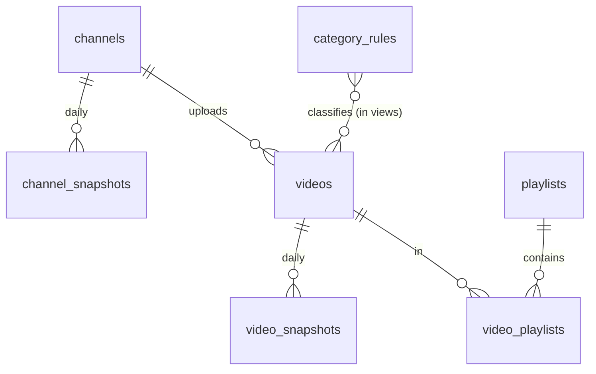

# Data model

Dataset: `<PROJECT_ID>.youtube_derana` (name set by `BQ_DATASET`).

The pipeline loads raw data into **tables**; all reporting logic lives in **views**, so changing a rule or a formula never requires reloading data.

## Tables

| Table | Grain | Load method | Notes |
|-------|-------|-------------|-------|
| `channels` | one row per channel | MERGE | title, handle, uploads playlist |
| `channel_snapshots` | channel × capture day | replace day's partition | subscribers (public, rounded), lifetime views, video count. Partitioned by `capture_date` |
| `videos` | one row per video | MERGE | title, publish time, duration, format, `first_seen_ts` / `last_seen_ts` |
| `video_snapshots` | video × capture day | replace day's partition | views, likes, comments. Partitioned by `capture_date`, clustered by `video_id` |
| `playlists` | one row per playlist | MERGE | title, item count, `last_scanned_at` |
| `video_playlists` | video × playlist | MERGE | many-to-many link; links are kept once seen |
| `category_rules` | one row per rule | replaced each run | copy of `config/category_rules.json` |
| `pipeline_runs` | one row per run | append | status, counts, API units used, error message |

`capture_date` is the UTC date of the run and `capture_ts` the UTC timestamp, as required. Re-running on the same UTC day overwrites that day's snapshot rows.

## Views

Created by every run in file order from `sql/views/`.

| View | Grain | Purpose |
|------|-------|---------|
| `v_runs` | capture day | capture time, previous capture, `report_date`, `is_latest` |
| `v_video_playlist_primary` | video | main playlist + all playlists |
| `v_video_category` | video | `category`, `program` from the rules |
| **`v_report_daily`** | video × capture day | **the required daily reporting dataset** |
| `v_video_daily` | video × capture day | `views_gained`, `likes_gained`, `comments_gained` since previous capture |
| `v_channel_daily` | day | channel KPIs, uploads, moving average, anomaly flag |
| `v_weekly_summary` | calendar week | week-over-week trends |
| `v_rolling_comparison` | single row | last 7 days vs previous 7 days |
| `v_videos_latest` | video (latest capture) | windows, timing, growth, peer benchmark, momentum |
| `v_window_videos` | video × time window | 24h / 7d / 28d lists with ranks |
| `v_window_summary` | window × format | counts and totals per window |
| `v_breakdown_daily` | day × format × category × program | views/engagement gained |
| `v_time_slots` | slot × hour × weekday × format | publishing time performance |
| `v_anomalies` | event | channel and video spikes/drops |
| `v_data_freshness` | single row | latest capture, last run status |

### `v_report_daily` – required fields

| Required field | Column |
|----------------|--------|
| Video ID | `video_id` |
| Video title | `video_title` |
| Channel name | `channel_name` |
| Playlist ID | `playlist_id` (main playlist; NULL when the video is in no playlist) |
| Playlist name | `playlist_name` (NULL when not available) |
| Channel ID | `channel_id` |
| Publish date and time | `publish_datetime_utc` (also `publish_datetime_local`) |
| Video duration | `video_duration` (H:MM:SS) and `duration_seconds` |
| Like count | `like_count` (NULL if the channel hides likes) |
| View count | `view_count` |
| Comment count | `comment_count` (NULL if comments are disabled) |
| Data capture date | `data_capture_date` (UTC) |
| Data capture timestamp in UTC | `data_capture_timestamp_utc` |

Extra columns: `report_date`, `video_format`, `format_method`, `category`, `program`, `all_playlist_ids`, `all_playlist_titles`, `playlist_count`, `video_url`.

## Key definitions

| Term | Definition |
|------|-----------|
| `report_date` | Local calendar day (`REPORT_TIMEZONE`) of the midpoint of the 24-hour window ending at the capture. With the default 00:05 Asia/Colombo schedule it is simply "yesterday". |
| Views gained (channel) | Change in the channel's lifetime view count between two captures; includes views on videos of any age. |
| Views gained (video) | Change in a video's view count between captures. A video's first capture counts in full only when it was published after the previous run. |
| Likes / comments gained | Sum of video-level changes for tracked videos (published within `LOOKBACK_DAYS`). |
| Uploads | Videos published between the previous capture and this one. |
| Time windows | Last 24 hours / 7 days / 28 days counted back from the latest capture timestamp, by publish time. |
| Engagement | likes + comments. Engagement rate = engagement ÷ views. |
| Format | `Short`, `Long-form`, `Live / Upcoming`. `format_method` records how it was decided. |
| Main playlist | Playlist whose name matches a category rule, else the smallest playlist, else alphabetical. |
| Performance index | Views ÷ median views of videos with the same format and age bucket (0-1, 1-3, 3-7, 7-14, 14-28, 28+ days). ≥2 top performer, <0.5 underperformer, needs ≥5 peers. |
| Momentum | (views last 7 days ÷ views previous 7 days) compared with the peers' median ratio. Below half the peers' ratio = dropped; above 1.5× = rising. |
| Channel anomaly | Daily views per day with a z-score ≥ 2 (spike) or ≤ −2 (drop) against the previous 14 days; needs 7 days of history. |
| Video spike | A video gaining ≥ 3× its own average of the previous 7 captures and at least 1,000 views. |
| Time slot | Publish hour in `REPORT_TIMEZONE`: Late night 00-06, Morning 06-10, Midday 10-14, Afternoon 14-18, Prime time 18-22, Late evening 22-24. |
